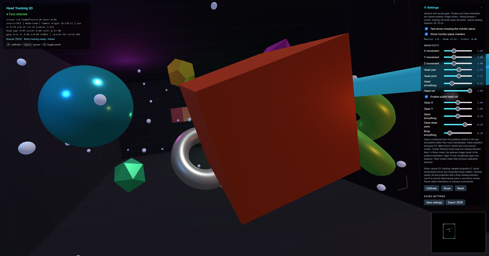

# HeadTracking3D — Your Screen Becomes a Window

**A webcam-powered, head-tracked 3D illusion for ordinary desktop monitors.**

Move your head to the left and you see around objects from the left. Lean to the right and new surfaces become visible. Move closer and the virtual scene responds to your changed viewing position. Instead of simply rotating a conventional game camera, the application uses your head position to change the perspective of a 3D scene relative to the screen.

This is a modified and extended version of [**AralimNGA/head-tracking-3d**](https://github.com/AralimNGA/head-tracking-3d), which provides the original browser-based Three.js / MediaPipe fish-tank VR foundation. The colorful floating shapes, particles and virtual room remain from that demonstration. Our additional tracking, camera, depth, fallback, and configuration work is described below.

> **Attribution:** The upstream project is by Aralim (AralimNGA) and is MIT-licensed. The original copyright and license notice are preserved in [LICENSE](LICENSE). This modified edition is **not an official upstream release**.

## The idea: looking *through* the monitor

The central inspiration is **Johnny Chung Lee's 2007 “Head Tracking for Desktop VR Displays using the WiiRemote”** demonstration: [watch the original video](https://www.youtube.com/watch?v=Jd3-eiid-Uw).

Lee used the Wii Remote's infrared camera and head-mounted infrared markers to locate the viewer. The screen behaved like a window into a 3D room. As the viewer moved, objects at different virtual depths shifted against each other, just as they would when looking through a real window. It was a compelling example of **head-coupled perspective**, sometimes called *fish-tank VR*.

Here, the **webcam and GPU replace the dedicated Wii/infrared tracking hardware**. MediaPipe estimates your head position and orientation from the camera image; Three.js renders the view with a perspective that responds to those measurements. You do not need a headset, handheld controller, IR markers or specialized tracking hardware.

### Why this is not merely zoom or camera shake

Imagine a physical window frame fixed in front of you with several objects hanging at different distances behind it:

1. **Move sideways:** nearby and distant objects move by different amounts relative to the frame (*motion parallax*). You can see around the sides of the same cube without spinning the cube itself.
2. **Move up or down:** the view changes vertically; surfaces previously hidden can come into view.
3. **Move toward the screen:** the virtual view changes with viewing distance. In the extended **Room** mode, an additional bounded *immersion travel* control can move the viewpoint into the scene rather than just magnifying it.
4. **Turn or tilt your head:** optional head yaw, pitch and roll affect the virtual viewing direction. Iris-based gaze can add a smaller independent adjustment.

The **monitor remains the physical display boundary**. Nothing is optically projected outside its actual pixels; the feeling of objects extending toward you or passing the screen plane is a viewpoint-dependent illusion, clipped by the edges of the display. For the cleanest Lee-style window effect, choose **Window** mode. The more exploratory **Room** mode deliberately adds virtual movement and rotation; it is not a strictly measured physical reconstruction of your space.

## Screenshot



*The screen becomes a window into a virtual 3D world. Real-time head tracking adjusts the viewing perspective, creating natural motion parallax and spatial depth without VR hardware.*

### Try the effect in 30 seconds

- Sit roughly **50–75 cm** from your webcam, with your face visible and evenly lit.
- Start in **Window** mode. Look at a cube and slowly shift your head left and right. Watch its visible faces and its position relative to the objects behind it; compare this with simply zooming a flat image.
- Switch to **Room** mode and repeat. Then approach and retreat from the display; experiment with **Room depth** and **Immersion** to control where the virtual room begins and how far you can move through it.
- Optionally enable **Monitor-plane markers** and the depth-test arrow to see how the fixed screen plane relates to the movable 3D room.

## What the upstream project provides

The foundation in [AralimNGA/head-tracking-3d](https://github.com/AralimNGA/head-tracking-3d) already includes:

- Webcam face tracking using **MediaPipe Face Landmarker**.
- **Three.js/WebGL** rendering with head-coupled, asymmetric (*off-axis*) projection.
- **Window, Hybrid and Look-around** viewpoints, and selectable head-position, head-rotation and eye-gaze input.
- A live webcam/tracking overlay, calibration controls, smoothing and sensitivity settings.
- The original scene of floating geometric primitives, particles, lights, room lines and atmospheric depth.

**Those are upstream features, not inventions claimed by this modified edition.**

## What this extended edition adds or refines

| Area | Extension / refinement |
|---|---|
| **Room viewpoint** | An additional **Room** mode: head position and orientation are referenced to the webcam frame, not forcibly made neutral wherever the face happens to be at startup. |
| **Depth & screen plane** | A fixed reference monitor plane (`z = 0`), adjustable **Room depth**, monitor-plane corner markers, and a test arrow that can cross the plane. |
| **Immersion / Z handling** | Bounded forward/backward virtual travel. In Room mode, most estimated Z motion becomes travel through the scene, while only a damped portion affects the projection; this limits excessive perspective distortion. |
| **Iris-based gaze** | Eye direction estimated using iris positions relative to eye boundaries rather than primarily using blendshape scores; separate X/Y gains, smoothing and dead zone. |
| **Head orientation** | Independent yaw/pitch sensitivity, enhanced eye-line/head-roll handling and configurable axis inversion. |
| **Tracking fallback** | Optional MediaPipe **Pose Landmarker Lite** body tracking if the face is lost, with relative body displacement, amplified fallback movement, and a gradual return toward neutral when tracking disappears completely. |
| **Continuity & stability** | Smoothing and speed-limited handovers designed to reduce camera jumps when the tracking source changes or a person reappears elsewhere in view. |
| **Diagnostics** | Additional head-axis/body-skeleton overlays, numeric status data, and an option to pause object animations for comparisons. |
| **Saved preferences** | Automatic local persistence of settings, manual save, **JSON export/import**, validation of stored values, and a restore-defaults action. |
| **Distribution** | English interface and documentation, plus Windows and macOS localhost launchers. |

More detail about the tracking mathematics, heuristics and design trade-offs is available in [docs/TRACKING-NOTES.md](docs/TRACKING-NOTES.md).

## Requirements

- Desktop computer with a modern **WebGL-capable** browser and webcam access (for example, recent Firefox or Chrome/Edge).
- Webcam with a clear view of the face; reasonable, stable lighting.
- **Python 3**, if you use one of the included localhost launchers. Any suitable local HTTP server can be used instead.
- Internet connection for loading Three.js, MediaPipe JavaScript/WASM and the face/pose models from their respective hosts. The project does not bundle those third-party dependencies.

**Privacy:** Webcam frames are processed locally inside the browser. This application does not implement webcam-frame uploads. It does make external requests for libraries and model files.

## Run it

**Windows:** Extract the ZIP, then run **`start-windows.cmd`**.

**macOS:** Run **`start.command`** (you may need `chmod +x start.command` first).

**Linux or manual:** From the extracted project directory:

```bash
python3 -m http.server 8765 --bind 127.0.0.1
```

Open **http://127.0.0.1:8765/index.html**, allow webcam access, and wait for the tracking model to load. Stop the local server with **Ctrl+C**.

Do not rely on opening `index.html` from a `file://` URL; webcam permissions and module loading are more reliable through localhost or HTTPS.

## Viewing modes and controls

| Mode | Intended behavior |
|---|---|
| **Room** (default) | Webcam-relative head XYZ movement, controlled rotation/gaze and bounded travel into/out of the virtual scene. |
| **Window** | Classic head-coupled off-axis projection; viewpoint position changes, but the viewing direction stays fixed. Closest to the original physical-window metaphor. |
| **Hybrid** | Off-axis perspective combined with head/eye rotation. |
| **Look-around** | Rotation-focused, conventional look-direction behavior. |

| Input | Action |
|---|---|
| **R** | Recalibrate tracking. In Room mode, updates distance and neutral eye gaze while preserving webcam-relative position/orientation. Other modes also capture head-pose offsets. |
| **Space** | Pause/resume tracking inference. |
| **H** | Show/hide the settings panel. |
| **Calibrate / Pause / Reset** | On-screen counterparts and tracking reset controls. |
| **Pause object animations** | Freeze the floating shapes without freezing the camera for visual comparisons. |
| **Save settings** | Save the current controls to this browser. |
| **Restore defaults** | Restore and save the included default settings. |
| **Export JSON / Import JSON** | Back up settings or move them between browser installations. |

### Saved settings and calibration

The chosen viewing mode, sliders, checkboxes and diagnostic display options automatically persist in browser `localStorage` for the current origin. JSON export/import is provided for portability. The internal storage identifier retains its previous name for **compatibility with existing saved configurations**.

**Not saved:** webcam frames, face/pose landmarks, temporary camera calibration, and current tracking measurements. Recalibration may be necessary in a new session. Settings do not automatically transfer between different browsers, ports or `localhost` versus `127.0.0.1`.

## Technology, files and verification

This is a small browser application with no JavaScript build step:

- `index.html` — scene, UI, Three.js off-axis camera, MediaPipe tracking, configuration persistence.
- `start-windows.cmd` / `start.command` — local HTTP-server launchers.
- `docs/TRACKING-NOTES.md` — technical notes, calibration/fallback behavior and key differences from upstream.
- `tests/` — optional Node.js regression checks for tracking, interface consistency and settings persistence.
- `LICENSE` — retained MIT copyright and license notice from the upstream project.

The application references **Three.js 0.160.0** and **MediaPipe Tasks Vision 0.10.9**, with externally hosted face/pose models. They are not redistributed here.

To run the included offline checks (Node.js required *only for testing*):

```bash
node tests/test-body-fallback-11.cjs
node tests/test-english-release.cjs
node tests/test-config-persistence.cjs
```

### Limitations

- Monocular webcam tracking provides **estimated** viewing motion, not metrically calibrated six-degree-of-freedom sensing. Room coordinates are stylized world units, not centimeters or meters.
- Viewpoint accuracy, perceived depth, tracking latency and jitter depend on the camera, illumination, monitor geometry, browser and GPU.
- Body-only fallback is less precise than face tracking; temporary occlusion can reduce tracking quality.
- This is a **desktop 3D interaction demo**, not a VR headset, a calibrated simulator or the separate laser-tag/maze game.

## Credits, origin and license

**Original software and source code:** [AralimNGA/head-tracking-3d](https://github.com/AralimNGA/head-tracking-3d), by **Aralim (AralimNGA)**. The upstream software is licensed under the **MIT License**; the original copyright and permission notice are retained verbatim in [LICENSE](LICENSE). This derivative edition is **not an official upstream release** and is not affiliated with or endorsed by the upstream author.

**Historical interaction concept:** **Johnny Chung Lee**, *Head Tracking for Desktop VR Displays using the WiiRemote* (2007). [Original demonstration](https://www.youtube.com/watch?v=Jd3-eiid-Uw). Lee's demonstration is credited as conceptual inspiration, **not as the source code of this project**.

**Extended implementation:** Additional room-relative head/camera behavior, bounded immersion travel, iris-gaze/roll refinements, optional body fallback, stability and transition logic, persistent settings, launchers and English documentation, developed on top of the original MIT-licensed project.
